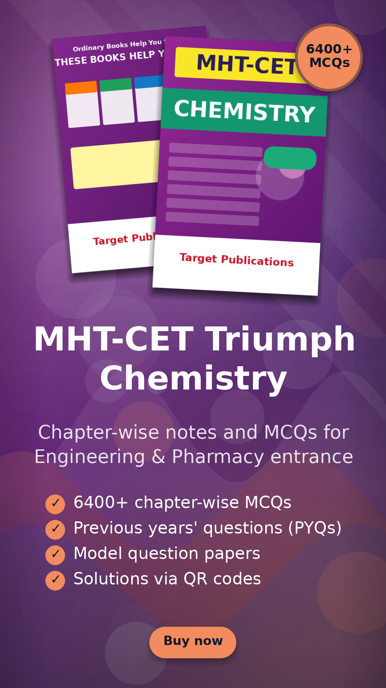
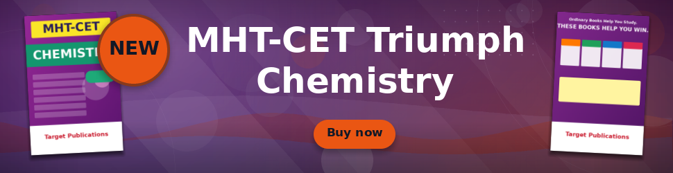
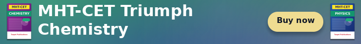
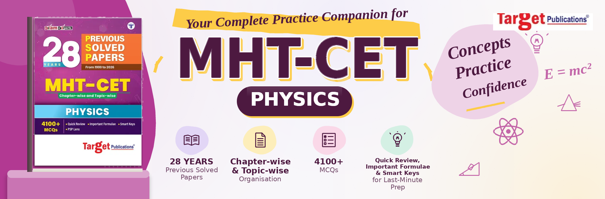
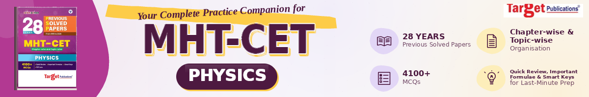
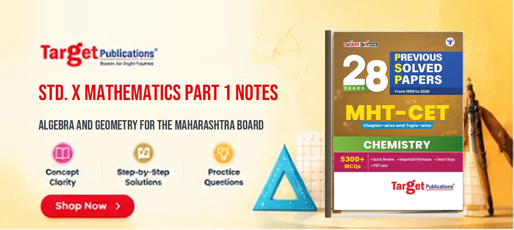

Laravel GD Ads
==============

Generate polished ad banners from product images with PHP and GD: book covers, boxes, bottles, courses, anything
with a packshot. Pick a size, give it images and copy, get a ready-to-publish PNG/JPG/WebP.

| Square (plain layout) | Story |
| --- | --- |
|  |  |








The plain-layout and showcase images come from `php examples/generate.php`, the illustrated ones from `php examples/companion.php` and
`php examples/templates.php`.

## What you get

- **Fluent builder**: one readable chain per ad.
- **Ad-size presets** (`AdSize`): 300x250, 728x90, 970x250, 300x600, 160x600, 320x50/100, 1080x1080, 1080x1350, 1080x1920, 1200x628 and more. Render one creative to many sizes with `renderSizes()`.
- **Layouts**: `stacked` (the plain layout: product(s) on top, text below; used for square, portrait, story and other non-wide sizes), `showcase` (wide banners: a cover on each side, message in the middle), `hero` (full-bleed photo with a scrim), `companion` (light illustrated ad) and the subject `template`s (finished artwork per subject). `auto` picks one from the size. Register your own with `AdBuilder::registerLayout()`.
- **Colour from the image**: the dominant brand hue becomes the background; headline and button colours are picked for readable contrast (WCAG AA).
- **Packshot cut-out**: a flat white studio background is removed, white areas inside the product are kept, and the baked-in drop shadow turns into a real soft shadow.
- **Auto-fitting text**: headline, sub-headline and tick-list shrink and wrap to fit any size; text that cannot fit is ellipsised.
- **Elements**: CTA button, round badge (`-30%`, `NEW`), logo, tick-list of selling points.
- **Backgrounds drawn from the covers**: the default `auto` (= `studio`) is a layered design: brand gradient, light beams, flowing waves, rings, dot grid, bokeh and a vignette. Also `paper` (light page), `mesh` (simple), `gradient`, `solid`, `blur`. The colours come from the front cover (the back cover only adds supporting tones). Plus the original `wave1`, `stripes`, `radial`, `spotlight`, `burst`, `medical`, ... and your own via `Backgrounds::register()`.
- **Output**: `toPng()`, `toJpg()`, `toWebp()`, `toDataUri()`, `save($path)`, `saveTo($storagePath, $disk)`.

## Subject templates (one artwork per subject)

Ten finished banners, one per subject, plus a generic one: `mathematics`, `science`, `english`, `hindi`, `marathi`,
`social-science`, `physics`, `chemistry`, `biology`, `evs-gk` and `general`. Each is a separate file in
`resources/templates/<name>.jpg` with its own subject background and props. The logo, benefit icons and the "Shop Now"
button are part of the artwork; the headline and tagline placeholder and the book are removed, and the library draws

- the product cover, as a 3D book standing where the template's book was (it covers the placeholder completely),
- the product title (headline) in the template's headline colour, auto-sized to fit, up to 3 lines,
- an optional tagline (`subheadline`) under it.

```php
use Packitifotech\Laragdads\Ads\Templates\TemplateLibrary;

TemplateLibrary::names();                       // mathematics, science, english, hindi, marathi, social-science, physics, ...
[$w, $h] = TemplateLibrary::dimensions('physics', 1200);   // the templates differ in proportions: 1200x524 here

Laragdads::ad()->size($w, $h)->images($cover)->template('physics')
    ->headline('Std. XII Physics Part 1')->subheadline('Chapter-wise notes and numericals')
    ->save('ads/physics.png');

// or let the subject choose (the title refines the choice; $variant rotates through related subjects):
$template = TemplateLibrary::pickFor($subjectName, $product->id, $product->title);
Laragdads::ad()->subject($subjectName, $product->id, $product->title)->size(...TemplateLibrary::dimensions($template))
```

Rendering at a size whose proportions differ from the template's by more than 20% throws and names the right size.
CTA, badge, features and logo of the builder are not used with templates: they are part of the artwork.

### Which template for which subject

Subject labels are normalised first (case, spacing, typos such as `Alegbra`, short forms such as `Eng/Mar/His`, `PCM`).

| Subject | Template |
| --- | --- |
| Physics / Chemistry / Biology | `physics` / `chemistry` / `biology` |
| Maths, Applied Maths, Algebra, Calculus, Trigonometry ... | `mathematics` |
| Science | `science` |
| English, Grammar, Vocabulary | `english` |
| Hindi, Sanskrit | `hindi` |
| Marathi, Lokvani | `marathi` |
| History, Geography, Civics, Political Science, Social Science | `social-science` |
| EVS, General Knowledge, Reasoning, children's / colouring / activity books | `evs-gk` |
| PCM, PCB, PCMB | rotates through the matching subject templates (by `$variant`) |
| Commerce, computer, psychology, art, mixed lists, anything unknown | `general` |

```php
TemplateLibrary::forSubject('PCM');     // ['physics', 'chemistry', 'mathematics']
Subjects::groups('Eng/Mar/His');        // ['languages', 'history']
Subjects::unknown('Some new subject');  // names the catalogue does not know yet
```

### Adding or replacing a template

`tools/prepare_templates.py` builds `resources/templates/` (cleaned plates + `manifest.php`) from the designers' artwork: it
removes the label and the headline / tagline placeholders and records where the copy zone and the book are. Supplying
higher-resolution originals gives sharper banners: adjust the boxes at the top of the script and run it again.
`php examples/templates.php` writes one banner per template.

## Companion layout (light, illustrated)

A friendly light-page design: handwritten tagline on a yellow brush stroke, a huge sticker-style title with a dark
subject pill, four icon cards, a handwritten slogan on a blob with subject doodles, the logo at top right and a 3D
book on a brand-coloured blob. Wide (2000x661) and 6:1 strip (1200x200) versions. See `php examples/companion.php`.

```php
Laragdads::ad()->size(AdSize::WEBSITE_BANNER)->images($cover)->logo($logo)
    ->tagline('Your Complete Practice Companion for')
    ->hero('MHT-CET', 'PHYSICS')
    ->highlights([['book', '28 YEARS', 'Previous Solved Papers'], ['doc', 'Chapter-wise & Topic-wise', 'Organisation'],
                  ['list', '4100+', 'MCQs'], ['bulb', 'Quick Review, Important Formulae & Smart Keys', 'for Last-Minute Prep']])
    ->slogan('Concepts', 'Practice', 'Confidence')
    ->save('ads/companion.png');
```

Icons (`Support\Icons::names()`): book, doc, list, bulb, atom, incline, prism, flask, cap, star, check, target, pencil, compass.
`->artwork($png)` melts a picture on a white background into the bottom-right corner; `->scriptFont()` sets the handwritten font.

## AI backgrounds (AI Horde / Stable Horde)

Let a Stable Diffusion model paint the background art, in a different style each time. Only the *background* is
AI generated: the cover, headline and buttons are still drawn by the layout, so the model never has to
spell anything. A contrast scrim is added automatically so the text stays readable on any result.

```php
Laragdads::ad()->size(AdSize::LANDSCAPE)->images($cover)->headline('...')->cta('Buy now')
    ->aiBackground('random')                 // or 'neon-cyber', 'chalkboard-doodle', 'blueprint-science', ...
    ->save('ads/ai.png');

$ad->lastAi();       // ['style' => 'space-galaxy', 'prompt' => '...']  what was used
$ad->lastAiError();  // why it fell back to the built-in background (null when AI worked)
```

- **Styles:** `cinematic-bokeh`, `flat-geometric`, `watercolor`, `neon-cyber`, `paper-cut`, `luxury-gold`,
  `chalkboard-doodle`, `blueprint-science`, `fluid-gradient`, `memphis-fun`, `space-galaxy`, `low-poly`, or `random`
  (`->aiBackground('random', seed: 7)` makes it reproducible). Or pass your own `prompt:`.
- **Colours:** the default prompt names the cover's colours ("deep purple and vivid orange") so the art matches the product.
- **Key:** set `AIHORDE_API_KEY` in your environment (never commit it). Get a free key at https://aihorde.net/register.
  Without one the anonymous key is used, which has the lowest queue priority.
- **Speed:** about 10 to 40 seconds per image, depending on the queue. Results are cached on disk by prompt, size and
  seed, so re-rendering the same ad (or the same ad in other sizes) is instant. Run it in a queued job in production.
- **Failure:** if the Horde is down, the queue is too long or the job is rejected, the ad falls back to the built-in
  background (one automatic retry first). Pass `strict: true` to throw instead.
- **Education scenes (default):** `aiBackground()` picks a scene from the ad's headline and title: a physics concept or science lab
  for Physics, an exam hall or classroom for board papers, a chemistry lab for Chemistry, a study desk for MCQ books, and so on
  (`classroom`, `exam-hall`, `study-desk`, `library`, `science-lab`, `physics-concept`, `chemistry-lab`, `maths-geometry`,
  `biology-lab`, `notebook-desk`, `graduation`, `books-stack`). `'abstract'` gives the old abstract art instead.
- **Readability:** with a photographic background a frosted panel is put behind the text automatically (`->textPanel(false)` turns it off); `->textAlign('left'|'center'|'right')` sets the alignment.
- **Wide banners:** backgrounds are generated natively wide (1152x192 for 6:1 strips, 1024x256, 960x320) with panoramic prompts
  written for each scene (a row of books on a shelf, a long lab bench, rows of exam desks ...), not cropped from a landscape photo.
  The overlay is kept light and the headline gets a soft shadow, so the scene stays visible.
- **Your own prompt:** `->aiBackground(prompt: 'wide panoramic photo, ...')` overrides the built-in one.
- **Strips (1200x200):** use the showcase layout (a cover on each side, the headline between) or the subject templates (`->template($name)` or `->subject($label)`, at the template's own proportions). AI backgrounds only apply to the layouts, not to the templates.
- **Try it:** `AIHORDE_API_KEY=... php examples/ai.php`.
- Needs `ext-curl`. Check AI Horde's terms and your use case before publishing generated images commercially.

## Requirements

- PHP 8.1+ with `ext-gd` (FreeType) and `ext-mbstring`
- Optional: `ext-curl` for AI backgrounds, `illuminate/support` (Laravel) for `saveTo()` and config

## Install

```bash
composer require packitifotech/laragdads
php artisan vendor:publish --tag=laragdads-config   # optional
```

## Quick start

```php
use Packitifotech\Laragdads\Laragdads;
use Packitifotech\Laragdads\Ads\AdSize;

Laragdads::ad()
    ->size(AdSize::LANDSCAPE)                              // or ->size(1200, 628)
    ->images(public_path('chemistry-front.png'), public_path('chemistry-back.png'))
    ->headline('MHT-CET Triumph Chemistry')
    ->subheadline('Chapter-wise notes and MCQs for Engineering & Pharmacy entrance')
    ->features(['6400+ chapter-wise MCQs', "Previous years' questions (PYQs)", 'Model question papers'])
    ->cta('Buy now')
    ->badge('6400+ MCQs')
    ->saveTo('ads/mht-cet-chemistry.png');                 // Laravel disk; or ->save('/abs/path.png')
```

One creative, every placement:

```php
$files = Laragdads::ad()
    ->images($cover)->headline('MHT-CET Triumph Chemistry')->cta('Buy now')
    ->renderSizes([AdSize::SQUARE, AdSize::STORY, AdSize::LEADERBOARD, AdSize::MEDIUM_RECTANGLE]);

foreach ($files as $label => $binary) {                    // "1080x1080" => PNG bytes
    Storage::put("ads/{$label}.png", $binary);
}
```

A long `"Title | tagline"` headline is split automatically into a headline and a subheadline.

Front cover left, back cover right (the classic wide strip, showcase layout):

```php
Laragdads::ad()->size(AdSize::STRIP)->images($front, $back)
    ->headline('JEE Main Mathematics Absolute Vol 2 Notes with MCQs | As per latest syllabus issued by NTA')
    ->save(storage_path('app/ads/strip.png'));
```

### Builder reference

| Method | Purpose |
| --- | --- |
| `size(AdSize\|int $w, ?int $h)` | canvas size |
| `images(...$paths)` | product images (paths or `GdImage`); layouts use the first two |
| `logo($path)` | brand logo |
| `headline()`, `subheadline()`, `cta()`, `badge()` | copy |
| `features(array)` | tick list, up to 5 items, shown when the format has room |
| `font($path, $bodyFont = null)` | TrueType/OpenType font (DejaVu Sans Bold is bundled) |
| `layout($name)` | `auto`, `stacked`, `hero`, `showcase`, `companion` or a registered one |
| `background($style)` | see `Backgrounds::names()` |
| `theme($hex \| [r,g,b] \| $imagePath \| Theme)` | brand colour or the image to sample colours from |
| `imageFit('cover'\|'contain')`, `cutout(bool)`, `shadows(bool)` | image placement |
| `format('png'\|'jpg'\|'webp', $quality)` | encoding used by `toBinary()`/`save()` |

### Fonts and languages

Pass any TTF/OTF that has the glyphs you need, for example Noto Sans Devanagari for Hindi/Marathi copy:
`->font(resource_path('fonts/NotoSansDevanagari-Bold.ttf'))`, or set `default_font` in `config/laragdads.php`.

### Custom layout and background

```php
Backgrounds::register('brand', fn (Canvas $c, AdSpec $spec, Theme $t) => $c->gradient($t->backgroundFrom, [10, 10, 30], 'vertical'));
AdBuilder::registerLayout('mine', new MyLayout());   // implements Layouts\Layout
```

## Legacy API

The original static methods (`createHorizontalAdsBanner`, `createVerticalAdsBanner`, `createBlockAdsBanner`, `saveAdsBannerPng`, `saveAdsBannerJpg`) still work. `saveAdsBannerPng/Jpg` no longer send HTTP headers, and JPG quality is now 90 instead of 9.

## Tests

```bash
composer install && composer test
```

## Credits

Author: Tushar Sawant. Colour extraction by [color-thief-php](https://github.com/ksubileau/color-thief-php), text by [gd-text](https://github.com/stil/gd-text). Bundled font: DejaVu Sans (free licence, see https://dejavu-fonts.github.io/License.html).
